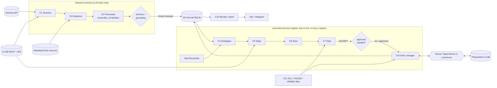

# PYTHIA — Architecture

> Canonical design spec. It supersedes `docs/design/02-architecture.md` (frozen input) and folds in the
> research in `docs/research/`. Decision ids (D-0xx, T-0xx) point to [`DECISIONS.md`](DECISIONS.md);
> rule ids (R##) to [`RULES.md`](RULES.md); PM rules to §15. Status 2026-10-08: **design, nothing built.**

**One sentence.** The LLM *reads and estimates*; deterministic code *decides, sizes, signs and places*
(ARGUS: "Analyst, not trader").

## 0. Principles (each one is enforced in code, not just stated)

1. **Same code paper and live.** Strategies, sizer, gate and journal run unchanged against `PaperVenue` or `LiveVenue` (T-001). Paper evidence is only worth something if this holds.
2. **The market is the prior.** The forecast that sizes a trade is `q = blend(calibrated LLM, market)` with the LLM weight earned on our own forward record. An LLM alone loses to liquid markets ([research/02](research/02-llm-forecasting-agents.md)).
3. **Abstaining is a first-class answer.** AMBIGUOUS, INSUFFICIENT and RESOLVED_IN_SUBSTANCE are verdicts, not errors (ARGUS F-001).
4. **The venue is truth** for orders, positions and balances; the journal is the audit trail (R27, T-005).
5. **Maker first.** Makers pay no fee; winners post limits, losers cross spreads ([research/04](research/04-earnings-and-capital-reality.md), D-023).
6. **Every stake is sized as a total loss.** Polymarket has no stops and no reduce-only.
7. **Untrusted text never steers.** Market text, rules, comments and fetched pages are data in `<evidence>` blocks; the LLM has no tools with side effects and no order fields.
8. **Fail closed, refuse loudly.** A safety check that cannot run counts as failed; the process refuses the *action*, not itself, and alerts (R70, R73).

## 1. Scope

**v1 (Phases 1–3).** Market scanner; evidence retrieval; LLM forecaster ensemble; calibration, blending and scoring; P1 strategy; weather strategy #2 in paper (D-022); neg-risk observer; paper simulator; live adapter with canary and $50 live; journal; alerts; Telegram approvals; daily report.

**Not in v1.** Market making / liquidity rewards (P4), arbitrage execution, latency or in-play trading, web UI (D-020), cross-venue, combos RFQ, perps. **Live** trading of `version == "v2"` markets (ExchangeV3, signing domain "3"; net-new markets tentatively from ~2026-11-02) waits until the canary has exercised that signing and redeem path; v2 markets *are* forecast, scored and paper-traded ([research/05](research/05-venue-technical-facts.md) §9, [synthesis](research/00-research-synthesis.md)).

## 2. System context



## 3. Processes and trust boundaries

| Unit (systemd) | Linux user | Runs | Environment holds | From |
|---|---|---|---|---|
| `pythia-recorder.service` (long-running) | `research-process` | Market WS datafeed; book and trade recorder into `market-*.db`; P3 neg-risk observer | nothing secret | Phase 1 |
| `research-process.timer` (hourly) | `research-process` | Scan (all markets, area tagging), evidence, forecasts | LLM, search and news keys (`research.env`) | scan: Phase 1; LLM: Phase 2 |
| `execution-process@<env>.service` (one instance per env: `paper`, `canary`, `live`; pid lock R51) | `execution-process` | Strategies → edge → sizer → gate → orders, every 60 s plus WS events; heartbeat task | **paper:** nothing secret. **canary/live:** session key (or fallback hot key), Telegram token (`exec.env`) | skeleton loop and snapshot: Phase 1; trading: Phase 2 |
| `pythia-jobs.timer` (15 min / daily) | `research-process` | Resolutions, paper settlement, calibration refit (weekly), daily report, nightly DB backup, venue-changelog diff (monthly) | read-only API access | Phase 1 |
| `pythia-watch.timer` (5 min) | `execution-process` | Dead-man check of every exec snapshot → ntfy (R70), plus an off-host ping | ntfy topic | Phase 1 |

- **Two Linux users enforce PM3** (T-014). `research-process` cannot read `exec.env` and `execution-process` cannot read `research.env`: both files are 0600 and owned by their user. Both users are in group `pythia`, which has write access to `var/`. Units use `ProtectProc=invisible`, `ProtectSystem=strict`, `ProtectHome=yes` and `ReadWritePaths=` limited to `var/`.
- Processes share **only** the SQLite files (WAL mode, `busy_timeout`). Research writes forecasts; exec reads them.
- Nothing is shared with ntx or ARGUS (users, env files, keys). Secrets are `EnvironmentFile`s, never argv (R61).
- Each exec instance has its own risk state, snapshot and switch paths (`var/<env>/`). Environments: `paper`, `canary` (live venue, `canary_*` caps), `live`. `pythia canary` writes a plumbing intent to the journal, and `execution-process@canary` picks it up.

## 4. Package layout (one clear purpose per module)

```text
pythia/
  config/      settings.py (pydantic models; params carry denominators, R4), load.py (YAML + env)
  domain/      types.py: Market, Token, Book, Level, Trade, Forecast, Intent, Decision, Order, Fill,
               Position, Resolution — frozen dataclasses / pydantic, Decimal money, no I/O
  venue/       base.py (Venue protocol), live.py (polymarket-client adapter), paper.py (simulator),
               fees.py (feeSchedule → fee per share), ticks.py (tick/size rounding, R17), errors.py
  data/        gamma.py, clob.py (books, prices-history), datafeed.py (WS market channel),
               recorder.py (book snapshots for forecasts and paper fills)
  universe/    scanner.py (filters → scoring universe + trading shortlist), filters.py
  evidence/    sources/ (rss, gdelt, exa, tavily, brave, jina, wiki, fred, noaa), scrub.py (wrap +
               injection flags, ARGUS port), allowlist.py, cache.py
  llm/         router.py (ARGUS port + USD meter + global ceiling), providers/, schemas.py (Strict
               base), prompts/*.md (versioned), forecaster.py (ensemble), golden/ (eval suites)
  forecast/    aggregate.py (log-odds median, spread), calibrate.py (one calibrator on the aggregate, T-010),
               blend.py (log-odds market blend), score.py (Brier, log loss, ECE, bootstrap)
  strategy/    base.py (Strategy protocol), p1_llm_longtail.py, weather.py, observers/negrisk.py
  engine/      edge.py (book walk, maker/taker edge), sizer.py (Kelly + caps + min size),
               gate.py (ordered rules), intents.py (intent ids, T-003), orders.py (state machine),
               reconcile.py, settle.py (resolution, redemption)
  journal/     db.py, migrations/NNN_*.sql, ledger.py (hash chain), queries.py
  ops/         lock.py, switches.py (KILL/PAUSE/ARMED), geoblock.py, assertions.py (R64),
               alerts.py (ntfy, R75), approvals.py (Telegram), snapshot.py, report.py, atomic.py
  cli.py       `pythia scan | forecast | exec | jobs | report | doctor | golden | arm | pause | kill | canary` (§18)
config/        base.yaml, paper.yaml, canary.yaml, live.yaml, models.yaml, sources.yaml, strategies.yaml
deploy/        systemd units, env templates (no values), install script
tests/         unit/, contract/ (recorded venue fixtures), golden/, drills/ (every limit trips)
var/           pythia.db, snapshots, reports (git-ignored)
```

Dependency direction: `domain` ← everything; `venue`, `data`, `llm`, `evidence` are adapters; `engine`
and `strategy` depend on `domain` and protocols only, so they test without network.

## 5. Data flow

### 5.1 Research cycle (hourly)

1. **Scan.** Pull **all** active markets and events (Gamma, paginated, token-bucket ≤ the documented limits). Record every one in `scan_results`, with its area (`config/areas.yaml`, D-037). Global filters are only `acceptingOrders`, not `restricted` and a readable `feeSchedule`. Each strategy then applies its own **`universe:` block** from `config/strategies.yaml`, such as P1's 3–45-day window and binary-only rule, P6's daily temperature events, or depth minimums. A market can be eligible for several strategies. Deterministic exclusion rules (area, event-slug denylist, keyword and resolution-domain regex) run here, without any LLM. v2 markets are eligible for paper; live waits for the canary (D-030). Tag each with category tags (geopolitics tag 100265 is fee-free; still read `feesEnabled`). Output for P1: the **scoring universe** (≈ 15 new markets/day within measured LLM capacity, chosen by the seeded sampler in §8) and **trading shortlist** (subset passing liquidity and fee filters). Hash rules text + clarifications per market. Volume filters use the Data API `*_usdc` fields; bare `volume` fields are **shares**, not USD.
2. **Select for (re)forecast.** New markets from the scoring universe; re-forecast only markets with positions or resting orders, on a price move > `reforecast_move_prob`, a rules-hash change or new evidence (§8). Never on a timer.
3. **Evidence.** Rules + `resolutionSource` always; discovery via Google News RSS + GDELT; 2–3 search queries via Exa → Tavily → Brave (quota-rotated); top 3–5 pages via Jina Reader; per-category structured sources. Every item scrubbed, injection-flagged and wrapped as `<evidence id source fetched_at>`; ≤ 12k tokens; cached per (query, day). URLs inside market text are never followed.
4. **Forecast.** §8. Each sample is a strict-JSON verdict; validated; grounded; aggregated.
5. **Freeze.** Write the forecast with model ids, prompt version hash, evidence hashes, and the **book snapshot at T** (best bid/ask, depth, mid, fee rate). This frozen row is the unit of forward evaluation; it is never updated.

### 5.2 Exec loop (every 60 s, plus WS events)

1. **Reconcile** (C8a): venue open orders, positions, balance (live: user WS + `/v2/positions?user=`; paper: simulator state). Cannot read → no new orders, alert (R73).
2. **Safety:** KILL/PAUSE files, geoblock cached result (refreshed daily and at start), start-up assertions passed (R64), risk state (HWM, daily loss) loaded from disk (R55).
3. **Strategies propose** `Intent`s from the latest valid forecasts and live books.
4. **Edge → sizer → gate** per intent; every outcome journaled with the rule that decided it.
5. **Approval** (live: first `approval_first_n_trades` trades, D-017; canary: every order): Telegram message with market, side, price, size, q, edge and the forecast's one-paragraph reading; Approve/Reject buttons; expires in 15 min → REJECT.
6. **Order manager** places, re-quotes or cancels. Safety action first, journal second (R54).
7. **Snapshot** state JSON atomically for the watchdog and the report.

### 5.3 Jobs

Resolution watcher (Gamma `closed` / `umaResolutionStatus`, WS `market_resolved`), paper settlement at the payout (including 50-50), live redemption (§11.6), weekly calibration refit, daily report, SDK/venue contract canary (nightly, read-only).

## 6. Domain types (selected)

| Type | Key fields |
|---|---|
| `Market` | condition id, question, rules text, rules hash, end date, tags, `neg_risk`, tick, min size, `feeSchedule`, tokens (YES/NO ids), state |
| `Forecast` | id, market id, created_at, verdict, samples[(family, model, p_raw, latency, tokens)], p_agg, spread, prompt version, evidence ids + hashes, book snapshot at T, ttl_until |
| `Intent` | strategy id, market id, token id, side, fair value `q`, style (MAKER/TAKER), limit price, desired stake, expiry, forecast id, `cluster_id` (event / city-day / market), `edge_source`, **intent id** (T-003) |
| `Decision` | intent, edge (maker/taker), sized stake and shares, gate result (ACCEPT/SHRINK/REJECT + rule id), equity snapshot |
| `Order` | intent id, signed payload + order hash, state (§11.3), price, size, filled, fees, env |

Money and prices are `Decimal`; probabilities are `float` in `[0, 1]` and named `_prob` (R4).

## 7. Strategy interface

```python
class Strategy(Protocol):
    id: str                       # "p1_llm_longtail", "weather_temp", "obs_negrisk"
    observe_only: bool            # observers journal intents; nothing reaches any venue
    def wants(self, market: Market) -> bool: ...                     # universe filter
    def propose(self, ctx: StrategyContext) -> list[Intent]: ...     # pure: forecasts + books in, intents out
```

- `StrategyContext` exposes frozen forecasts, live books, current positions and the strategy's remaining budget. No network, no clock reads (time is injected), so strategies are unit-testable.
- Each strategy has `budget_equity_pct` and its own journal tag. Global caps still apply across all strategies (§10).
- A strategy produces **fair value and intent**, never size. Size is the sizer's job.
- P1 and weather differ only in where `q` comes from: LLM ensemble vs a deterministic weather model. Both go through the same calibrate → blend → edge → sizer → gate path. Specs in [`STRATEGIES.md`](STRATEGIES.md).

## 8. Forecasting pipeline (C3 + forecast/)

**Pass 1 — no price.** Input built by code: question, rules + clarifications (never truncated), resolution source, end date, today's date, code-computed facts (days to resolution, base-rate hints from structured sources), evidence blocks. Output, one discriminated shape (ARGUS F-087):

```json
{"verdict": "FORECAST|AMBIGUOUS|INSUFFICIENT|RESOLVED_IN_SUBSTANCE",
 "p_yes": 0.37, "key_evidence_ids": ["e3", "e7"], "resolution_reading": "...",
 "ambiguity_notes": "...", "base_rate_note": "..."}
```

Validators: `p_yes` in [0.01, 0.99] iff FORECAST; every cited evidence id exists in the prompt (grounding); no extra fields; one repair attempt then fall through to the next model.

**Search queries.** A separate small LLM role writes 2–3 search queries from the title and rules only, never from fetched text. Queries are validated (length, charset, no URLs) before they reach any search API, so injected text cannot steer retrieval.

**Ensemble.** `K = 3` samples per market (config), one per model, across **≥ 2 model families** (T-008). Same-model samples correlate ≈ 0.7, so diversity beats repetition. Research suggests K = 5–6, but free capacity is ~95–135 long calls/day and G2 needs markets more than samples; a paper ablation of K = 3 vs 6 on a subset decides.
- A = the strongest free model, with high thinking.
- B = a cheap second Google sample.
- C = a mandatory non-Google family.

If no non-Google family is reachable → NO_FORECAST, never a single-family forecast. Role chains (model order per role) live in one place, [DATA_SOURCES §3](DATA_SOURCES.md); the roster is D-036. The ARGUS router gaps to fix are listed in research/07 §5, where they are numbered R1–R11; here they are cited as **RF1–RF11** so they don't clash with RULES ids. Limits are **measured** on our keys in week 1, not read from docs.

**Gated cohorts are pinned (T-015).** While a cohort is under a gate, forecast roles A/B/C have **no fallback**: if a pinned model is unavailable, the forecast is NO_FORECAST plus an alert, and the market simply goes unscored. Fallback chains still apply to every other role (query writer, rules parsing, JSON repair) and to exploratory runs. That way a 429 can never silently change the system under test.

**Aggregate.** Median in log-odds. If the inter-sample spread exceeds `max_sample_spread_logit` → INSUFFICIENT (disagreement is information). Verdicts:
- any sample AMBIGUOUS or RESOLVED_IN_SUBSTANCE flags the market for the rules path (P2);
- majority INSUFFICIENT → abstain.

**Calibrate.** **One** calibrator on the *aggregate* of a frozen ensemble definition. Identity until `calib_min_resolved` (500; Platt gains were only measured at ≥ 500 forecasts, [research/02](research/02-llm-forecasting-agents.md)). Always clip to `p_clip` [0.03, 0.97]. A refit creates a new calibrator version, and therefore a new cohort.

**Blend.** `logit(q) = w·logit(p_cal) + (1 − w)·logit(p_mkt)`, where `p_mkt` is the mid at forecast time T.
- `w = w_prior` per strategy: P1 0.30 (the literature prior from *liquid* markets, ≈ ⅓), P6 0.50.
- `w` is held fixed through G2 and the first live phase. It changes only through a separately pre-registered refit after G2 with ≥ 500 resolved forecasts.
- An exploratory shadow at `w = 0.5` for P1 (the thin-market candidate) is logged but never gates or trades.

**Cohort and as-of record.** Cohort = (model roster, prompt hash, calibrator version, `w`, `config_hash`). The `config_hash` covers all role chains, the query-writer and scrub prompts, K, token caps, the source allowlist, the universe block and the sampler version. Any change starts a new cohort; G2 is computed within one cohort. Each frozen forecast stores `p_agg`, calibrator version, `w`, `q`, `p_mkt` at T, the book snapshot and the cohort id. Nothing is recomputed later with newer parameters.

**Capacity and selection.**
- The daily call budget covers, in priority order: (1) re-forecasts of markets with positions or resting orders, (2) new markets from the scoring universe.
- When eligible new markets exceed capacity, a **seeded random sample** is drawn. It is a neutral, pre-registered selection, so G2 is not cherry-picked. Quota `p1_daily_new_markets` (15), at most `max_markets_per_event_per_day` (1), and seed = hash(date, cohort id), stored in `scan_runs`. A determinism test reproduces a past day's sample.
- Arithmetic (≈ 15 new markets/day): 15 × 3 samples + ~15 query/parse calls + ~10 repairs + ≤ 15 re-forecast samples ≈ 100 calls/day, inside the measured 95–135. Sample A (strongest model, ~20 RPD) is the binding model.
- **Per-consumer ceilings:** production calls count against `llm_daily_call_ceiling` (120); golden suites, ablations, probes and shadow tests count against a separate `llm_daily_call_ceiling_nonprod` (40), so evaluation work never starves production.

**Re-forecast triggers** (only for markets with positions or resting orders): price move > `reforecast_move_prob`, rules hash change, new evidence. `forecast_ttl_hours` (48) only stops trading on an old forecast; it never triggers a call by itself.

**Edge source.** Each decision is tagged `edge_source = forecast` (q differs from the mid because of the forecast) or `mechanical` (q ≈ mid, and the "edge" comes from a wide or stale book). P1 rejects mechanical edges; they belong to other strategies.

**Costs and ceilings.**
- A global daily call ceiling and per-model RPD guards (`llm_headroom_ratio` 0.9). Gemini resets at Pacific midnight.
- **Free first, then free credit, then paid** (D-015, D-036): the order per role is in DATA_SOURCES §3. Every call records its `tier` and `cost_basis` (`free`, `credit` for Vercel's monthly $5, `cash`).
- Caps are checked *before* each call on worst-case tokens. The cash cap `llm_usd_cap_month` (5) is the binding total, with per-provider sub-caps under it; Vercel credit use is limited by `vercel_credit_headroom_ratio`. All keys are in RISK §2. On cap → that tier stops and the chain moves on; if forecasting stops, positions are still managed; alert once (R50, R75).
- Prompts are cache-friendly (evidence first, sample-specific text last) and cached-token counts are logged.
- The snapshot reports `forecaster=llm` with model ids; a stub run is an alert (ARGUS F-145).

## 9. Edge and sizing (C5, C6)

**Fees from the venue.** Per market at decision time: `feesEnabled` and `feeSchedule{rate, exponent, takerOnly, rebateRate}` from Gamma. Skip a market if `exponent != 1` or `takerOnly != true` (unexpected shape). Taker fee per share at price `p`: `rate × p × (1 − p)`. Makers pay 0. Never infer fees from the category, `/fee-rate` (an on/off flag) or `takerBaseFee` ([research/05](research/05-venue-technical-facts.md) §3). Reconcile against the fee reported on each fill.

**Reading books.** `/book` lists bids **ascending** and asks **descending**: best bid = max(bids), best ask = min(asks). Never index `[0]`; a fixture test asserts this.

**Side.** For each market the strategy compares both tokens. It buys YES if its fair value `q` clears YES's executable price, and buys NO (fair value `1 − q`) if that clears NO's. Edge and size are always computed on the token actually bought.

**Edge per intent** (`c` = cost per share of the bought token, `f` = its fair value):
- Taker: walk the ask levels to the size → volume-weighted `c`; `edge = f − c − rate·c(1−c) − slip_margin_prob`.
- Maker: limit `b = min(f − min_edge_prob − adverse_sel_margin_prob, best_bid + 1 tick, best_ask − 1 tick)`, so a post-only order never crosses. If no such price ≥ the market's minimum tick exists, skip. `edge = f − b − adverse_sel_margin_prob`.
- Accept only `min_edge_prob ≤ edge ≤ max_edge_prob`. A huge "edge" usually means we misread the rules or the news.

**Size.**
1. Kelly for a contract paying 1 at cost `c`: `k = (f − c) / (1 − c)`; stake = `kelly_fraction × k × equity` (0.25).
2. **Cluster sizing.** Each intent carries a `cluster_id`: the event for neg-risk sets, the city-day for weather, and the market otherwise. Mutually exclusive outcomes in one cluster are sized together at their worst case (all but one lose), capped by `max_event_equity_pct`.
3. Caps only shrink (R5): per market, per cluster, per category, per strategy budget, total exposure (computed on **exposure if filled** = positions + resting buy orders), and capacity (≤ `max_depth_take_ratio` of displayed depth within our limit).
4. Shares = floor to the venue step (R17). Below the market's `min_order_size` (5 in every sampled market) → the **min-lot policy** (D-028, provisional, R14): round up to the minimum lot **only if** its cost ≤ the *full*-Kelly stake and ≤ every cap; otherwise **REJECT**. A SHRINK below `shrink_reject_ratio` (0.5) of the intended size becomes REJECT.
5. **Re-check at final size.** After any shrink, recompute the taker book-walk edge at the final size and re-apply the edge band (maker edge does not depend on size).

**Why the min-lot policy exists** (derived, [synthesis](research/00-research-synthesis.md)):
- A quarter-Kelly stake reaches a 5-share lot only when `edge ≥ 20·c(1−c)/E`. That is 0.10 at c = 0.5 and E = $50, and 0.033 at E = $150. With `w = 0.3` it needs ~30 points of LLM-vs-market disagreement, which is more often an error than an edge.
- Under strict R6, almost nothing would trade at $50. With the full-Kelly ceiling the threshold becomes `edge ≥ 5·c(1−c)/E` = 0.025 at mid and $50, so `min_edge_prob` binds instead. Each trade is then a min-lot bet of $0.25–5, inside the per-market cap.

**Equity = NAV**, the basis for caps, HWM, daily loss and drawdown:
- pUSD cash
- plus collateral reserved in resting buy orders
- plus positions marked at the **best bid** (live marks only, R22); resolved-but-unredeemed positions at their payout; positions with no bid at cost, flagged.

External flows (deposits, sweeps, top-ups) go to a `flows` ledger: they are excluded from PnL, and the HWM is flow-adjusted. Paper starts at `paper_start_equity_usd` (50) so that its min-lot effects match live.

## 10. Risk gate (C7): ordered rules, first REJECT wins

| # | Rule | Outcome |
|---|---|---|
| 1 | KILL latched; PAUSE active; (canary/live) `ARMED` missing for this env | REJECT |
| 2 | Geoblock not `false` within the last 24 h, or start-up assertions failed | REJECT |
| 3 | Forecast older than `forecast_ttl_hours`, or the mid moved > `forecast_material_move_prob` since T (R20) | REJECT |
| 4 | Verdict ≠ FORECAST, sample spread too wide, or an injection flag on any evidence | REJECT |
| 5 | (live) G2 **and** Gate C not passed for this strategy, or the forecast's cohort ≠ the gated cohort | REJECT |
| 6 | Within `blackout_hours` of the end date, end date ambiguous, or resolution in progress (Gamma `umaResolutionStatuses` non-empty, a JSON-string array; Data API `/v2/resolutions`) | REJECT |
| 7 | Rules hash changed since the forecast | REJECT + re-forecast |
| 8 | `edge_source = mechanical` (P1) | REJECT |
| 9 | Edge outside [`min_edge_prob`, `max_edge_prob`], re-checked at the final size | REJECT |
| 10 | Taker: depth at the limit < `min_depth_multiple` × shares. Maker: no non-crossing price, or spread < 2 ticks | SHRINK / REJECT |
| 11 | Caps on exposure-if-filled: market, cluster, category, strategy budget, total; `max_open_markets` | SHRINK |
| 12 | Daily loss ≥ limit → PAUSE; drawdown from the flow-adjusted HWM ≥ limit → KILL (R50, R55); PnL drift: abs(NAV − (baseline + flows + journaled PnL)) > max(`pnl_drift_usd`, `pnl_drift_equity_pct`) → PAUSE; `category_loss_streak` consecutive losses in a category → PAUSE that category | REJECT |
| 13 | Venue minimum not met after shrinking and the min-lot policy (R6, D-028) | REJECT |
| 14 | Order attempts in the last hour above `max_order_attempts_per_hour` (R19) | REJECT |
| 15 | (live) approval required (first `approval_first_n_trades` live trades) and not granted within `approval_expiry_minutes`. **After approval, rules 1–14 are re-run on a fresh book** before placing | REJECT |

Limits and defaults live in [`RISK_AND_CUSTODY.md`](RISK_AND_CUSTODY.md) §2. Each rule has a drill test that proves it trips (R50). Canary orders are plumbing orders, not strategy trades: they bypass rules 3–9 and 15, have their own caps (`canary_*`), and every one of them needs Telegram approval (BUILD_PLAN Phase 2c).

## 11. Execution (C8)

### 11.1 Venue interface

```python
class Venue(Protocol):
    env: Literal["paper", "canary", "live"]
    async def books(self, token_ids: list[str]) -> dict[str, Book]: ...
    async def place(self, order: SignedOrder) -> PlaceResult: ...        # idempotent per order hash (§11.5)
    async def cancel(self, order_hashes: list[str]) -> None: ...
    async def open_orders(self) -> list[Order]: ...
    async def positions(self) -> list[Position]: ...
    async def balance(self) -> Decimal: ...
```

`LiveVenue` wraps `polymarket-client==0.12.0` (import `polymarket`, `AsyncSecureClient`, hash-pinned; never the unofficial `polymarket` / `polymarket-sdk` PyPI packages). SDK defaults (retries, timeouts) are set explicitly (R76). The fallback if py-sdk breaks is `py-clob-client-v2` behind the same interface. HTTP clients send an explicit User-Agent; Python's default UA is refused by some endpoints (R25).

### 11.2 PaperVenue (no official testnet exists, [research/05](research/05-venue-technical-facts.md) §1)

- **Starting equity** = `paper_start_equity_usd` (50), so paper hits the same min-lot and cap constraints as live.
- **Taker fills:** snapshot `/book` at signal time, re-snapshot after a simulated 2 s latency, walk the levels up to the limit, and charge `rate·p(1−p)` per level. Fill only what displayed depth covers.
- **Maker fills (primary, pre-registered rule):** a resting paper order fills when a public trade prints strictly through our price, or at our price after the recorded queue ahead of us has traded. When we post a new best price, the queue ahead is 0.
  - Trades are ingested for **both tokens**: a NO trade at `y` is a YES-equivalent trade at `1 − y`, because complementary orders match by minting.
  - Source: Data API v2 trades per market, polled each loop and cross-checked with WS `last_trade_price`.
  - A "touch-fill" variant (fill when any trade prints at our price) is reported as exploratory only.
  - During the canary, shadow quotes are compared with real fills to calibrate this model.
- **Signing in paper:** orders are built and signed through the SDK's order builder with a **throwaway ephemeral key**, generated per process and never persisted. Paper therefore runs the same sign-once and journal-before-send code path as live (`signer_kind = paper_ephemeral`), and a paper UNKNOWN drill exercises reconciliation.
- **Rebates** are counted as 0, which is conservative.
- **Redemption lag:** settled cash becomes available after `paper_redeem_lag_hours`. The default is 168 (weekly owner redemption) until the canary proves automatic redemption; then it is set to the measured lag.
- **Live-only frictions, modelled:** each decision that would need Telegram approval in live is tagged `would_need_approval`, and paper applies `paper_approval_drop_ratio` (0.2, the expected share of expired proposals) to it. A simulated heartbeat loss cancels resting paper orders the same way the venue would.
- **Expiry and cancels** behave like GTD; post-only orders that would cross are rejected, as the venue does.
- **Settlement** at the resolved payout (1 / 0 / 0.5). Void or 50-50 markets are excluded from Brier scoring and counted separately.
- **Two P&Ls journaled:** simulated fills, and a "shadow" fill at the mid at signal time, so optimism in the fill model is visible.

### 11.3 Order state machine (TTL on every pending state, R20)

`INTENT → GATED → [APPROVAL_PENDING] → SIGNED → SUBMITTING → OPEN → PARTIAL → FILLED | CANCELLED | EXPIRED`;
`SUBMITTING → REJECTED | UNKNOWN`.
- `UNKNOWN` (timeout, 5xx, 425) never retries blindly; it follows §11.5.
- Attempts are counted (R19).
- HTTP 425 (engine restart) → wait; 503 → cancel-only mode; 429 → honour `Retry-After`.

### 11.4 Order styles

- **Maker (default):** post-only GTD at the §9 maker price. Expiry = min(forecast TTL, end − blackout), and at least 3 min (venue rule). Re-quoted when the forecast or book changes materially. Cancelled on rules change, KILL, PAUSE or geoblock: PAUSE cancels resting entry orders too.
- **Taker (exception):** FAK with a price cap at the book-walk limit, only when the taker edge clears `min_edge_prob` after fee (most often on fee-free markets). Never FOK; never a market order.
- **Exits:** hold to resolution by default. Sell early only if all of these hold:
  - `f < best_bid − fee − exit_margin_prob` on **two consecutive** forecasts;
  - the position is older than `min_hold_hours`;
  - the venue has confirmed the position on that token (R74).
- **Heartbeat:** a dedicated async task sends one every 5 s, independent of the 60 s loop and with no DB access, whenever live orders rest. The venue cancels **all** open orders 10–15 s after the last accepted heartbeat, so a crashed exec leaves no stale quotes. A drill test kills the task and asserts the orders reconcile as CANCELLED.

### 11.5 Intent ids and idempotency (T-003)

`intent_id = hash(strategy_id, market_id, token_id, side, forecast_id, limit_price)`. A new forecast or a new price is a new intention. No attempt counters.

CLOB V2 orders have **no verified client-id field** (V2 dropped `nonce`, `feeRateBps` and `taker`). The mechanism therefore does not depend on one:
1. **Sign once.** Build and sign the order, then journal the signed payload and its **order hash** linked to the `intent_id` *before* sending (journal-before-send).
2. **Send.** On UNKNOWN, reconcile by order hash against open orders and trades.
3. **Resubmit** only the **byte-identical** signed payload: the same hash means the venue cannot create a second order.
4. **Re-sign** a new order for the same intent only after reconciliation proves the previous one terminal (CANCELLED, EXPIRED, REJECTED). It becomes a new order row linked to the intent.

Phase 1 task: confirm that py-sdk can separate sign from post. If it cannot, matching by (token, side, price, size, placement window) is the fallback, and caller-supplied `salt` is checked as an alternative.

### 11.6 Reconciliation, settlement, redemption

- Reconcile at start, every loop, and after every UNKNOWN. Venue truth wins; a mismatch past its TTL is an alert and blocks new orders on that market (R72, R73).
- A session key sees only its own orders; reconcile with the credentials that placed them, plus public `/v2/positions?user=<deposit_wallet>`.
- Redemption: whether a session key or the AutoRedeemer redeems is **unverified**; it is tested with a ~$1 position during the canary. Until then redemption is an owner action folded into the weekly sweep.
- Protocol V2 markets (`version == "v2"`) redeem through a different path, which the SDK selects from `version`. It is rehearsed in the canary before live v2 trading.
- A position is forgotten only when the venue says it is resolved and redeemed (R49).

## 12. Storage

Full schema, conventions and the Postgres path: [`DATA_MODEL.md`](DATA_MODEL.md). In short:
- SQLite on the isolated server.
- `var/pythia.db` holds decisions and evidence, with insert-only tables and a hash chain per table.
- `var/market/market-YYYY-MM.db` holds high-rate market data, rotated monthly.
- `var/risk_state.json` (atomic, R55) holds the live risk state.
- Money, prices and shares are exact integers ×1e6; time is ISO UTC text.
- All SQL sits behind `pythia/journal/`, so moving to Postgres later means a new adapter plus a migration (DATA_MODEL §8).

## 13. Configuration

- YAML per environment layered on `base.yaml`; secrets only from env files. Files: `base.yaml`, `paper.yaml`, `canary.yaml`, `live.yaml`, `models.yaml` (roles, chains, measured limits), `sources.yaml` (allowlist, per-source limits), `strategies.yaml` (enable flags, budgets, `universe:` blocks), `areas.yaml` (tag → area map, area → strategy, exclusion rules, `reject_reason` codes, `map_version`). Every parameter name carries its unit (`_equity_pct`, `_usd`, `_prob`, `_shares`, `_hours`) (R4).
- A configured limit with no enforcing code and drill test is a defect (R50).

## 14. Operations

- **Switches** (files in `var/switches/`, written atomically): `KILL` (latched; cancel all resting orders, no new entries; never auto-resumes), `PAUSE` (cancel resting entry orders, no new entries), `ARMED.<env>` (**canary and live**; created only by `pythia arm --env <env>`, which makes the owner type a confirmation phrase; second independent switch with the systemd unit, R56). KILL does **not** auto-flatten into thin books unless the owner changes D-026.
- **Alerts:** ntfy, on change only (R75): start/stop, refused actions, reconciliation mismatch, geoblock change, caps hit, LLM cap hit, stub run, injection flag, dead-man (R70), daily loss/DD, approval requests (Telegram).
- **Daily report:** markdown + HTML in `var/reports/`, summary pushed to ntfy. Contents: forecasts made and resolved, Brier/log loss/ECE vs market (running), paper/live PnL per strategy after fees and LLM cost, gate rejection histogram, LLM usage vs limits, open positions, alerts.
- **Deploy:** pull-based on an isolated host as users `research-process` / `execution-process` (T-014); live is never restarted automatically (R57); `uv sync --frozen` with hashes.
- **Start-up assertions (R64):** geoblock false from this IP; CLOB `/ok`; clock skew vs `/time` < 2 s; SDK version equals the pin; schema version; fee schedule readable on a known market; tick/min size readable; (live) pUSD balance readable, allowances set, session key not within 14 days of expiry. Any failure → refuse to trade, alert.

## 15. Guardrails specific to this project (PM rules)

| ID | Rule |
|---|---|
| PM1 | The LLM never sees a wallet, key, order field or the market price in pass 1; its schema has no side, size or price. |
| PM2 | Market text, rules, comments and fetched pages are untrusted. No URL from them is fetched. An injection flag → REJECT the market for the day + alert. Adversarial tests are mandatory. |
| PM3 | The research process holds no wallet key; the exec process holds no LLM key and never calls an LLM. |
| PM4 | No VPN, proxy or relocation to pass a geoblock. Orders only from the isolated server. A block → cancel resting orders, no new entries, wind down (D-008). |
| PM5 | Forward-only evaluation: forecasts are frozen with timestamps; evaluation markets resolve after every model's training cutoff (R37 addition). |
| PM6 | Fees are read per market from `feeSchedule` at decision time, never from a table. |
| PM7 | Order identity comes from the intention (`intent_id`), never a counter; no blind resubmit of an UNKNOWN order (T-003). |
| PM8 | LLM spend: daily call ceiling and monthly USD cap enforced before each call; LLM cost is charged to strategy PnL. |
| PM9 | Only the official `polymarket-client` (hash-pinned). Never install `polymarket` or `polymarket-sdk`; never run third-party Polymarket bot code on the isolated server. |
| PM10 | Keys for this bot are separate from ARGUS and ntx (D-024). |

## 16. Testing

| Layer | What | How |
|---|---|---|
| Unit | fees, ticks, book walk, Kelly, caps, intent ids, calibration, blend, scoring | pytest, property tests for monotonicity (caps only shrink; fee ≥ 0) |
| Drills | every gate rule and limit trips; KILL/PAUSE/ARMED; restart preserves HWM/KILL | `tests/drills/`, one test per rule (R50) |
| Paper simulator | maker fills only on trade-through; taker never exceeds depth; settlement incl. 50-50 | fixtures of recorded books and trades |
| Contract | venue payload shapes, SDK pin, feeSchedule parsing | recorded fixtures + nightly read-only canary |
| Golden (LLM) | per-role suites incl. "agree" cases, ambiguous rules, resolved-in-substance, injection attempts | `pythia golden`, scored, run on prompt or model change (ARGUS F-136, F-019) |
| Mutation | load-bearing modules (sizer, gate, fees) | later phase (R43) |

Every bug fix starts with a failing regression test (R41).

## 17. When to revisit this architecture

| Trigger | Change |
|---|---|
| A book-level strategy (liquidity rewards, arbitrage) is promoted | Consider NautilusTrader 2.x for that strategy only |
| py-sdk breaks repeatedly in 0.x | Swap `LiveVenue` to `py-clob-client-v2` behind the same interface |
| Cross-venue (Kalshi) wanted | Evaluate `pmxt` as a second Venue adapter |
| Free LLM capacity collapses | Owner decides on the ≤ $5/month fallback (D-015) |

## 18. Interfaces (Phase 1 contract)

| Interface | Contract |
|---|---|
| CLI | `pythia <cmd> --env {paper,canary,live} [--config PATH]`. Exit codes: 0 ok · 1 refused (safety check failed, reason on stderr) · 2 config error · 3 venue/API unreachable. `doctor` runs every start-up assertion (R64) and prints pass/fail per check. `arm`, `pause`, `kill` only write or clear switch files. `canary` places one owner-approved plumbing order. `weather verify <template>` shows a parsed P6 city spec for the owner to confirm |
| Files | `var/pythia.db`, `var/market/market-YYYY-MM.db`, `var/weather/weather-YYYY-MM.db`, `var/<env>/risk_state.json`, `var/<env>/switches/{KILL,PAUSE,ARMED}`, `var/<env>/snapshot.json` (watchdog), `var/reports/YYYY-MM-DD.{md,html}`, `var/runs/<run_id>/` (config + git SHA + data hash per result, R42) |
| Env files | `research.env` (LLM, search, news keys) and `exec.env` (wallet / session key, Telegram token, ntfy topic), mode 0600, owned by `research-process` and `execution-process` respectively (T-014). Names in [`DATA_SOURCES.md`](DATA_SOURCES.md) §Keys |
| Make targets | `make check` (ruff + mypy + pytest), `make test`, `make golden`, `make drills`, `make deploy` (pull-based on the isolated server; never restarts live) |
| Config keys | Every key and default in [`RISK_AND_CUSTODY.md`](RISK_AND_CUSTODY.md) §2; unknown or missing keys fail start-up (exit 2) |
