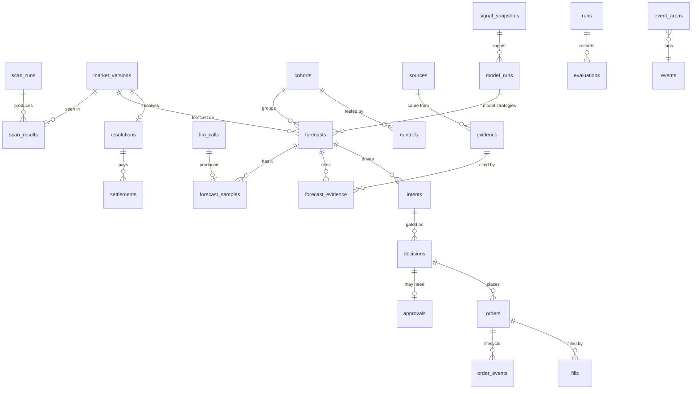

# Data model

> Canonical schema design for PYTHIA's storage. It replaces the table list in ARCHITECTURE §12,
> which now points here. The exact DDL is written test-first in the Phase 1 plan (task 1.3) and must
> match this document. Decision: **SQLite on the isolated server now; Postgres later only on a trigger** (§8).

## 1. Storage layout (on an isolated host, users `research-process` and `execution-process` (group `pythia`), under `var/`)

| File | Holds | Write rate | Retention |
|---|---|---|---|
| `var/pythia.db` | Everything a decision or an evaluation depends on: markets, forecasts, evidence, LLM calls, intents, decisions, orders, fills, positions, resolutions, NAV, risk events, controls, runs | low (hundreds of rows/day) | forever (it is the forward-test evidence) |
| `var/market/market-YYYY-MM.db` | High-rate market data: book snapshots, trade prints, raw WS events | high | 12 months, then deleted unless a `runs` manifest references it |
| `var/weather/weather-YYYY-MM.db` | Raw ensemble members and station observations (P6) | medium | 12 months; what a forecast used is copied into `pythia.db` |
| `var/risk_state.json` | HWM, KILL latch, daily loss, flows baseline (atomic write, R55) | on change | current only; history is in `risk_events` |
| `var/backups/` | Nightly `.backup` copies of `pythia.db` | daily | 14 days on the isolated server; a weekly copy is pulled off-box (OPERATIONS) |

**Why separate databases.** Recorder bursts must never hold the write lock that `exec` needs for an order event (T-011). Everything `pythia.db` needs from the high-rate data is **copied in** at the moment it matters, for example the book at forecast time and the trade that triggered a paper fill. So `pythia.db` is self-contained, and evaluation never depends on `market-*.db` retention.

## 2. Conventions (chosen so the move to Postgres is a migration, not a redesign)

| Topic | Rule | Postgres later |
|---|---|---|
| Tables | `STRICT` tables; `PRAGMA foreign_keys = ON`; WAL mode; `busy_timeout` set; short `BEGIN IMMEDIATE` transactions | same DDL, types mapped |
| Primary keys | `id TEXT` = ULID generated in code (sortable, no sequences). Natural ids from the venue (`condition_id`, `token_id`, `order_hash`) are `TEXT` with `UNIQUE` where they must be unique | `text` or `uuid` |
| Time | `TEXT` ISO-8601 UTC, fixed format `YYYY-MM-DDTHH:MM:SS.sssZ`, columns end in `_at` | `timestamptz` |
| Money, prices, shares | **Exact integers ×1e6** (pUSD has 6 decimals; ticks go down to 0.0001): `_usd_e6`, `_price_e6`, `_shares_e6`. Never `REAL` for money (R17) | `bigint` |
| Probabilities | `REAL` named `_prob` (estimates, not money) | `double precision` |
| Booleans | `INTEGER` 0/1 with `CHECK` | `boolean` |
| Enums | `TEXT` with `CHECK (col IN (...))` | enum or check |
| Payloads | `TEXT` holding canonical JSON (sorted keys, no spaces), columns end in `_json` | `jsonb` |
| Insert-only | Chained tables have triggers that `RAISE(ABORT)` on `UPDATE`/`DELETE`. State changes are new event rows; "current state" comes from views | triggers rewritten in PL/pgSQL |
| Hash chain (T-005, T-016) | Per table: each chained row stores `canon_json` (the canonical JSON of its payload at insert time), `hash_version`, `prev_hash` and `row_hash = sha256(prev_hash ‖ canon_json)`. Verification runs over the **stored** `canon_json`, never over current columns, so adding columns by migration never breaks old rows. Verified daily by `pythia doctor` | unchanged |
| Every row | `env TEXT CHECK (env IN ('paper','canary','live'))` where it applies | unchanged |
| SQL location | All SQL lives in `pythia/journal/` (repository functions, plain SQL, `?` params behind a thin adapter). No ORM; no SQLite-only functions outside JSON extraction in views | swap the adapter |

## 3. Entity-relationship overview

## 4. `pythia.db` tables

**C** = hash-chained and insert-only. Unmarked tables are insert-mostly, without a chain.

### 4.1 Universe

| Table | Key columns | Notes |
|---|---|---|
| `events` | `event_id` (PK, venue), `slug`, `title`, `neg_risk`, `tags_json`, `first_seen_at` | One row per venue event |
| `market_versions` | `id`, `condition_id`, `event_id`→events, `version` (`v1`/`v2`), `question`, `rules_text`, `rules_hash`, `resolution_source`, `resolution_domains_json` (code-extracted), `end_at`, `tags_json`, `neg_risk`, `yes_token_id`, `no_token_id`, `tick_price_e6`, `min_order_shares_e6`, `fees_enabled`, `fee_rate`, `fee_exponent`, `fee_taker_only`, `fee_rebate_rate`, `accepting_orders`, `restricted`, `payload_hash`, `seen_at` | **New row only when something material changes** (rules hash, fees, tick, min size, state). View `markets_latest` |
| `scan_runs` | `id`, `started_at`, `finished_at`, `n_seen`, `n_scoring`, `n_shortlist`, `sampling_seed`, `run_id`→runs | One per hourly scan; the seed makes the G2 random selection reproducible |
| `scan_results` | `scan_run_id`, `market_version_id`, `area_id`, `eligible_for_json` (strategy ids whose universe block accepted it), `selected_for_forecast`, `reject_reason` (enumerated codes in `config/areas.yaml`), `volume_24h_usd_e6` (from `*_usdc` fields), `best_bid_e6`, `best_ask_e6`, `mid_e6`, `spread_price_e6`, `depth_usd_e6`, `days_to_end` | Every seen market is recorded; feeds the power simulation (task 1.10) and selection-bias audits |
| `event_areas` | `event_id`, `area_id` (1–29, 30 = residual), `map_version`, `at` | Insert-only area tagging from `config/areas.yaml` (D-037) |
| `labels` | `id`, `subject_kind` (`market`, `event`, `evidence`), `subject_id`, `label_kind` (e.g. `single_decider`, `insider_case`, `subjective_source`, `relevant`, `injection`), `value`, `score_prob`, `source` (`rule`, `llm`, `jev`, `owner`), `source_ref` (rule id or call id), `at` | Exclusions and classifications from any producer; the owner's labelled set for the Jev shadow test lives here |

### 4.2 Evidence and LLM

| Table | Key columns | Notes |
|---|---|---|
| `sources` | `source_id` (PK, e.g. `gdelt_doc`), `category`, `auth`, `terms_note`, `enabled` | Seeded from `config/sources.yaml`, which mirrors [DATA_SOURCES.md](DATA_SOURCES.md) |
| `search_queries` | `id`, `condition_id`, `llm_call_id`→llm_calls, `source_id`, `query_text`, `n_results`, `at` | Written by the query-writer role; validated text only |
| `source_calls` | `id`, `source_id`, `endpoint_kind`, `condition_id`, `http_status`, `status`, `units_used`, `cost_usd_e6`, `latency_ms`, `at` | Ledger for every non-LLM API call; per-source quotas and rotation are derived from it (limits in `config/sources.yaml`) |
| `evidence` | `id`, `source_id`→sources, `url`, `url_hash`, `title`, `language`, `published_at`, `fetched_at`, `content_text` (trimmed), `content_hash`, `injection_flags_json` | Untrusted text. `UNIQUE(url_hash, content_hash)` deduplicates |
| `llm_calls` | `id`, `role` (validated against the role list in `config/models.yaml`: `forecast_A`, `forecast_B`, `forecast_C`, `query_writer`, `parse_rules`, `json_repair`, `classify`, `reader_fallback`, `research_ensemble`), `purpose` (`prod`, `golden`, `probe`, `ablation`, `shadow`), `strategy_id`, `run_id`, `attempt_group_id`, `parent_call_id`, `tier` (`free`, `credit`, `paid`), `chain_index`, `provider`, `model`, `family`, `prompt_version`, `prompt_hash`, `params_json` (effort, temperature, max_tokens), `input_tokens`, `cached_input_tokens`, `reasoning_tokens`, `output_tokens`, `latency_ms`, `cost_basis` (`free`, `credit`, `cash`), `list_price_usd_e6`, `cost_usd_e6`, `status` (`ok`, `rate_limited`, `server_error`, `timeout`, `schema_fail`, `refused`), `error_class`, `condition_id`, `started_at` | Every call, including failures. Source of LLM cost, quota and per-consumer ceilings |

### 4.3 Forecasts and evaluation

| Table | Key columns | Notes |
|---|---|---|
| `cohorts` **C** | `id`, `strategy_id`, `roster_json`, `prompt_hash`, `calibrator_version`, `w_prior`, `config_hash` (all role chains, query-writer and scrub prompt hashes, K, token caps, source allowlist, universe block, sampler version), `created_at` | Frozen system definition (T-010, T-015) |
| `forecasts` **C** | `id`, `strategy_id`, `forecast_kind` (`llm_ensemble`, `model`), `cohort_id`→cohorts, `model_run_id` (model strategies), `set_id` (one event-level set at one T, e.g. all weather buckets), `market_version_id`, `created_at` (= T), `horizon_hours`, `g2_group_key` (strategy, cohort, horizon), `verdict`, `p_agg_prob`, `sample_spread_logit`, `p_cal_prob`, `w`, `q_prob`, `p_mkt_prob` (mid at T), `book_at_t_json` (best bid/ask, depth, both tokens, fee schedule), `evidence_config_hash`, `ttl_until` | One row per forecast for every strategy. LLM-only columns are null for `forecast_kind = model`. The gate unit is the first forecast per `g2_group_key` and market |
| `forecast_samples` **C** | `id`, `forecast_id`, `llm_call_id`, `family`, `model`, `verdict`, `p_yes_prob`, `key_evidence_ids_json`, `resolution_reading`, `ambiguity_notes`, `base_rate_note`, `raw_json`, `grounding_ok` | K rows per P1 forecast |
| `forecast_evidence` | `forecast_id`, `evidence_id`, `cited` | Which evidence was in the prompt and which was cited (grounding check) |
| `calibration_fits` **C** | `id`, `calibrator_version`, `method`, `n_resolved`, `params_json`, `data_hash`, `fitted_at`, `run_id` | Identity fits are recorded too |
| `controls` **C** | `id`, `cohort_id`, `kind` (`permutation_null`, `no_below_65`), `run_id`, `summary_json` (per-rep PnL distribution, p-value) | Pre-registered G2 controls |
| `runs` **C** | `id`, `kind` (`report`, `g2`, `power_sim`, `calibration`, `golden`, `backtest_study`), `git_sha`, `config_hash`, `data_hash`, `started_at`, `output_path` | R9/R42 manifest for every number we quote |
| `evaluations` **C** | `id`, `run_id`, `strategy_id`, `cohort_id`, `horizon_hours`, `slice` (`all` or an exploratory slice), `as_of`, `n_markets`, `n_events`, `metrics_json` (Brier/RPS diff, CI, log loss, ECE, PnL, control p-values), `look` (`early_kill`, `final`, `extension`, `interim_report`) | Gate looks are rows here; interim and slice rows never decide |

### 4.4 Decisions, orders, fills

| Table | Key columns | Notes |
|---|---|---|
| `intents` **C** | `intent_id` (PK = hash, T-003), `strategy_id`, `forecast_id`, `cluster_id`, `condition_id`, `token_id`, `outcome` (`YES`/`NO`), `fair_value_prob`, `style` (`MAKER`/`TAKER`), `limit_price_e6`, `desired_stake_usd_e6`, `expiry_at`, `edge_source`, `created_at`, `observe_only` | Observers write intents with `observe_only = 1` |
| `decisions` **C** | `id`, `intent_id`, `env`, `edge_prob`, `edge_final_prob`, `book_at_decision_json`, `stake_usd_e6`, `shares_e6`, `result` (`ACCEPT`/`SHRINK`/`REJECT`), `gate_rule` (1–15), `reason`, `nav_usd_e6`, `exposure_if_filled_usd_e6`, `created_at` | Every gate outcome, including rejects |
| `approvals` **C** | `id`, `decision_id`, `requested_at`, `responded_at`, `response` (`APPROVE`/`REJECT`/`EXPIRED`), `message_ref`, `regate_decision_id` | Re-gate after approval links to a new decision row |
| `orders` **C** | `id`, `intent_id`, `decision_id`, `env`, `order_hash` (UNIQUE), `signed_payload_json`, `parent_order_id` (re-sign after a terminal state), `token_id`, `side`, `price_e6`, `shares_e6`, `order_type` (`GTD`/`GTC`/`FAK`), `post_only`, `expires_at`, `book_at_placement_json`, `queue_ahead_shares_e6`, `signer_kind` (`paper_ephemeral`, `session_key`, `hot_key`), `created_at` | Written **before** sending (journal-before-send, T-012) |
| `order_events` **C** | `id`, `order_id`, `state` (`SIGNED`, `SUBMITTING`, `OPEN`, `PARTIAL`, `FILLED`, `CANCELLED`, `EXPIRED`, `REJECTED`, `UNKNOWN`, `RECONCILED`), `filled_shares_e6`, `http_status`, `venue_message` (scrubbed), `at` | View `orders_current` = latest state per order |
| `fills` **C** | `id`, `order_id`, `env`, `venue_trade_id`, `price_e6`, `shares_e6`, `fee_usd_e6`, `is_maker`, `trigger_trade_json` (paper: the print that caused it), `fill_model` (`live`, `paper_strict` = the ARCHITECTURE §11.2 rule incl. queue-ahead; `paper_touch` exploratory), `tx_hash`, `at` | Paper fills carry their evidence inline |
| `shadow_fills` | `id`, `intent_id`, `mid_price_e6`, `shares_e6`, `at` | Mid-price shadow PnL (honesty check on the fill model) |

### 4.5 Positions, money, risk

| Table | Key columns | Notes |
|---|---|---|
| `venue_positions` | `id`, `env`, `snapshot_at`, `token_id`, `shares_e6`, `source` (`data_api`, `user_ws`, `paper`) | Venue truth snapshots (R27) |
| `resolutions` **C** | `id`, `condition_id`, `outcome` (`YES`, `NO`, `SPLIT_50_50`, `VOID`), `resolved_at`, `uma_statuses_json`, `source` | Void/50-50 excluded from Brier, counted |
| `settlements` **C** | `id`, `env`, `condition_id`, `token_id`, `shares_e6`, `payout_usd_e6`, `available_at` (paper: + redeem lag), `redeemed_at`, `method` (`paper`, `auto`, `owner`), `tx_hash` | |
| `flows` **C** | `id`, `env`, `kind` (`DEPOSIT`, `SWEEP_OUT`, `TOP_UP`, `REBATE`), `amount_usd_e6`, `at`, `tx_hash`, `note` | Excluded from PnL; HWM is flow-adjusted (T-013) |
| `costs` **C** | `id`, `strategy_id`, `kind` (`llm`, `data`, `gas`), `amount_usd_e6`, `period_date` | Charged to strategy PnL (PM8) |
| `nav_snapshots` | `id`, `env`, `at`, `cash_usd_e6`, `reserved_usd_e6`, `positions_mark_usd_e6`, `nav_usd_e6`, `hwm_usd_e6`, `daily_pnl_usd_e6` | Every exec loop; feeds the daily-loss, drawdown and PnL-drift rules |
| `marks` | `id`, `env`, `token_id`, `at`, `best_bid_e6`, `best_ask_e6`, `mark_e6`, `method` | Live marks only (R22) |
| `risk_events` **C** | `id`, `env`, `kind` (`PAUSE`, `UNPAUSE`, `KILL`, `ARM`, `DISARM`, `CAP_HIT`, `PNL_DRIFT`, `CATEGORY_PAUSE`, `GEOBLOCK`, `ASSERTION_FAIL`), `detail_json`, `at` | |
| `alerts` | `id`, `dedup_key`, `severity`, `message`, `channel`, `sent_at` | Alert on change (R75) |
| `doctor_checks` | `id`, `run_at`, `check`, `ok`, `detail` | Start-up and daily assertions (R64) |

### 4.6 Strategy-specific

| Table | Key columns | Notes |
|---|---|---|
| `negrisk_episodes` (P3) | `id`, `event_id`, `started_at`, `ended_at`, `sum_asks_price_e6`, `fee_usd_e6`, `net_edge_prob`, `executable_shares_e6` | Observe-only |
| `weather_specs` (P6) | `id`, `city_template`, `station_id`, `unit`, `rounding`, `window_local`, `no_data_rule`, `rules_hash`, `parsed_by_llm_call_id`, `owner_verified_at` | Typed spec; trades only when `owner_verified_at` is set |
| `model_runs` **C** (generic: P6, P10–P12) | `id`, `strategy_id`, `model`, `model_version`, `init_at`, `inputs_json` (signal snapshot ids and hashes), `params_json`, `outputs_json` (e.g. bucket probabilities, ratings, implied distribution), `created_at` | One row per deterministic model run; forecasts point to it |
| `signal_snapshots` (generic) | `id`, `source_id`, `subject_kind` (`station`, `team`, `match`, `underlying`, `external_market`), `subject_id`, `metric` (e.g. `ens_member_tmax`, `elo`, `odds_decimal`, `implied_vol`, `ext_prob`), `as_of_at`, `fetched_at`, `value_json`, `value_hash`; `UNIQUE(source_id, subject_kind, subject_id, metric, as_of_at, value_hash)` | Numeric inputs for model strategies (odds, ratings, options data, Kalshi prices). High-rate raw values stay in the monthly DBs; what a model run used is copied here |
| `settled_values` (P6) | `station_id`, `local_date`, `metric` (`tmax`, `tmin`), `value`, `unit`, `source_id`, `published_at` | The official settlement value per station-day, as the rules define it |

## 5. `market-YYYY-MM.db` tables

| Table | Key columns | Recording policy |
|---|---|---|
| `book_snapshots` | `id`, `token_id`, `at`, `best_bid_e6`, `best_ask_e6`, `bids_json`, `asks_json` | Full depth: at forecast time, decision time and order placement. Top of book: every minute for tokens with resting paper or live orders; hourly for every market with a frozen forecast until it resolves (the permutation null and the controls re-run on these) |
| `trade_prints` | `id`, `venue_trade_id` (UNIQUE), `condition_id`, `token_id`, `price_e6`, `size_shares_e6`, `side`, `at`, `source` | Both tokens of **every market with a frozen forecast**, until resolution: the paper fill model, the permutation null and the controls all need them |
| `ws_events` | `id`, `channel`, `type`, `payload_json`, `received_at` | Raw market-channel events, kept for debugging and replay |

Estimated size at v1 scale: tens of MB per month (estimate; measured in Phase 1, task 1.3).

## 6. Key views

| View | Purpose |
|---|---|
| `markets_latest` | Latest `market_versions` row per `condition_id` |
| `orders_current` | Latest `order_events` state per order |
| `positions_paper` | Paper positions derived from fills and settlements (paper has no venue) |
| `g2_unit` | First forecast per market for each `g2_group_key`, joined to its resolution, excluding void and 50-50; carries the event id for the cluster bootstrap |
| `strategy_pnl` | Realised + marked PnL per strategy, minus fees and `costs` |

## 7. How each data source lands in the model

| Data source group ([DATA_SOURCES.md](DATA_SOURCES.md)) | Lands in |
|---|---|
| Gamma markets/events | `events`, `market_versions`, `scan_results` |
| CLOB books, Data API trades, market WS | `market-*.db` (`book_snapshots`, `trade_prints`, `ws_events`); copied into `forecasts.book_at_t_json` and `fills.trigger_trade_json` when they matter |
| Data API positions, user WS (live) | `venue_positions`, `order_events`, `fills` |
| Gamma `umaResolutionStatuses`, Data API resolutions | `resolutions`, gate rule 6 |
| News, search, reader, reference, social, official data | `sources`, `search_queries`, `evidence` → `forecast_evidence` |
| LLM providers | `llm_calls`, `forecast_samples`, `costs` |
| Weather forecasts and observations | raw in `weather-YYYY-MM.db`; used values in `signal_snapshots` → `model_runs`; settlement values in `settled_values` |
| Sports odds and ratings, esports ratings, options data, cross-market prices (P10–P12, later) | `signal_snapshots` → `model_runs` → `forecasts` (no schema change needed) |
| All non-LLM API calls | `source_calls` |
| Area tagging and exclusions (rules, Jev, owner labels) | `event_areas`, `labels`, `scan_results.reject_reason` |

## 8. When and how to move to Postgres

**Stay on SQLite while:** one host, one exec writer per environment, `pythia.db` under ~5 GB, measured lock waits within budget.

**Move when any of these happens:** a second host must write; lock waits exceed the budget in two consecutive weeks; a read-only dashboard or analytics need concurrent remote reads; `pythia.db` exceeds ~5 GB.

**How:**
1. Apply the same schema with the type mapping in §2.
2. Port the insert-only triggers.
3. Copy table by table in chain order.
4. Re-verify every hash chain on the Postgres side.
5. Run the full test suite against Postgres through the journal adapter.
6. Switch `research` first, then `exec` (after a KILL-and-reconcile window).

## 9. Backups and integrity

- Nightly `sqlite3 .backup` to `var/backups/pythia-YYYYMMDD.db`; keep 14 days.
- `pythia doctor` checks every hash chain, foreign keys (`PRAGMA foreign_key_check`), `PRAGMA integrity_check`, and the schema version daily. Any failure → refuse new entries + alert (R73).
