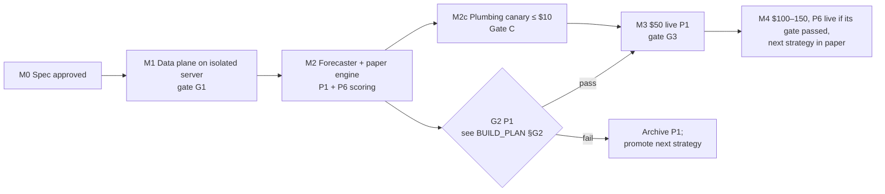

# Roadmap

Direction and milestones. Tasks and acceptance criteria live in [BUILD_PLAN.md](BUILD_PLAN.md);
strategy specs in [STRATEGIES.md](STRATEGIES.md). Dates are not promised: forward tests are
paced by when markets resolve. A milestone is reached when its gate passes, not on a date.

## Milestones

| Milestone | Proves | Depends on |
|---|---|---|
| M0 Spec approved | Owner and agent agree on scope, risk, gates | Owner review of these docs |
| M1 Data plane (G1) | Scanner, recorder, journal, alerts, watchdog run 7 days unattended on an isolated host | M0 |
| M2 Forecaster + paper engine | Frozen forecasts, paper fills, daily scoring for P1 and P6 | M1, forecasting prerequisites |
| M2c Plumbing canary (Gate C) | Signing, maker/taker fills, reconciliation, fees, redemption, sweep, with ≤ $10 | M2 engine, approved canary prerequisites |
| M3 $50 live P1 (G3) | Live edge not worse than paper; PnL ≥ 0 after costs | G2 pass + Gate C |
| M4 Scale + second strategy | Edge holds at 2× size; P6 or the next strategy earns its own gate | G3 |

## Now / Next / Later

**Now (M0 → M1)**
- Owner: confirm decisions, first commits, keys.
- Agent: Phase 1 implementation plan (`docs/plans/`), then the data plane: scanner, recorder, journal, alerts, P3 observer.

**Next (M2)**
- Forecaster, router with measured limits, golden suite, paper engine, P1 scoring.
- P6 weather in paper (decide the data source licensing first).
- Plumbing canary once the engine exists and a wallet is funded.

**Later (M3+)**
- $50 live P1 after G2.
- Offline P2 study (near-resolution bonds) and the forward log of rules-reading calls.
- P4 read-only reward recorder (needs a 1-minute loop decision).
- Monthly venue-changelog diff job: fees, delays, rewards and the oracle changed at least 9 times in 2026.
- P7 mention markets, P8 wallet-flow feature, P9 dispute log.
- Neg-risk joint forecasting so P1 can trade multi-outcome legs.
- **Area expansion (D-037):** P10 sports models (NFL/CFB/MLB/soccer first: strongest free data, valid historical backtests) → P11 esports (largest sport by volume) → P12 crypto price ladders. Each starts in paper behind its own pre-registered gate; area keys are fetched only when that strategy starts.

## Capital path (only on evidence)

| Step | Float | Condition |
|---|---|---|
| Canary | ≤ $10 | Engine built; wallet funded |
| L1 | $50 | G2 + Gate C |
| L2 | $100 | +20 resolved live trades with G3 holding |
| L3 | $150 | +20 more resolved live trades with G3 holding |
| Beyond | owner decision | Needs a strategy with capacity; long-tail P1 likely caps at a few thousand dollars deployed ([research/04](research/04-earnings-and-capital-reality.md)) |

## Earnings and capital reality ([research/04](research/04-earnings-and-capital-reality.md))

| Fact (verified 2026-10-07) | Number |
|---|---|
| Wallets that lose money (on-chain studies) | 68–84% |
| Share of profits taken by the top 1% of winners | 76.5% |
| $5k profit in one month ranks about | #2,372 (top ~0.5% of active wallets) |
| Addresses with ≥ $5k profit in 4 consecutive months | 0.015% |
| Bots: share of wallets / share of trades | 0.54% / 63% |
| Famous small-bankroll bots (crypto up/down, weather) | $0.1–0.9M/month for ~4–5 months, then ~$0 after spring 2026 |
| LLM bots with documented profit after fees | none found; live LLM test: −16% to −31% (Kalshi), ≈ −1.1% (Polymarket) |
| Capacity of a small market | ≈ $36/day absorbed |

**Capital needed (derived: target ÷ net monthly return)**

| Net monthly return | For $5k/month | For $10k/month | Evidence that this return is durable |
|---|---|---|---|
| 1% | $500k | $1M | Large market makers, arbitrage desks |
| 2% | $250k | $500k | Best durable documented range |
| 5% | $100k | $200k | Rare; capacity-limited |
| 10% | $50k | $100k | Only in niches that later faded |
| 20% | $25k | $50k | Only short-lived bot edges |

**What $50–150 can do in 3 months:** at an optimistic 20%/month, $100 grows by about $73. The realistic purpose of this phase is evidence: either a credible edge with a live record, or a clean kill. Long-tail P1 likely caps at a few thousand dollars deployed regardless of bankroll, so income at the $5–10k scale would need different, higher-capacity strategies and real capital, decided only after the evidence exists.
