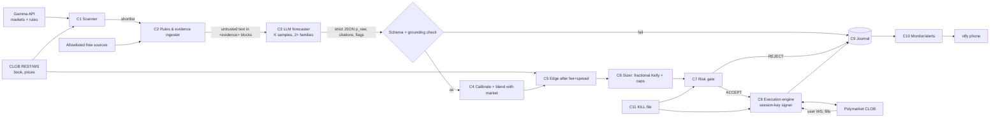

> Sanitized public copy of an earlier design input; the canonical specifications may supersede it.

# 02 — Architecture

**One sentence:** the LLM *reads and estimates*; deterministic code *decides, sizes, signs and
places*.

This is the ARGUS rule "Analyst, not trader. Agents score, argue, and propose; code sizes,
gates, executes" (`argus-project/docs/LLM_AGENTS.md` l.9), applied to binary contracts.

Stack (decided in `01`):

- Python 3.12;
- official `polymarket-client` (py-sdk), pinned by version and hash;
- SQLite journal;
- systemd on the shared hosting provider remote box;
- ntfy alerts.

**No NautilusTrader.**

## 1. Components

| # | Component | Deterministic? | Does | Never does |
|---|---|---|---|---|
| C1 | **Market scanner** | yes | Pulls active events/markets from Gamma. Filters by category, days-to-resolution, volume, spread, book depth, fee rate, and `neg_risk`. Emits a shortlist | Call an LLM; trade |
| C2 | **Rules & evidence ingester** | yes | Stores the rules text, resolution source, clarifications and end date for each shortlisted market. Fetches evidence from an **allowlist** of free sources. Hashes everything | Follow URLs found inside market text |
| C3 | **LLM forecaster** | no (bounded) | Per market: K independent samples across ≥2 model families → probability + cited evidence + rule-ambiguity flags, as strict JSON | See the wallet, prices it may anchor on in pass 1, any tool with side effects |
| C4 | **Calibrator / blender** | yes | Maps raw LLM p → calibrated q (fitted on *our* resolved forward record), then blends with the market price | Run before ≥ N resolved forecasts exist (until then q = market price, so no trade) |
| C5 | **Edge calculator** | yes | Edge = q − executable price − taker fee − slippage margin, per side, at actual book depth | Use mid or last price |
| C6 | **Sizer** | yes | Fractional Kelly on calibrated q, then caps (`04` §2), then venue minimums; rejects if below the minimum (ntx R6) | Round up to reach a minimum |
| C7 | **Risk gate** | yes | Ordered rule list → ACCEPT / SHRINK / REJECT; every outcome journaled | Be bypassed by any flag |
| C8 | **Execution engine** | yes | Limit orders only (GTC/GTD, FOK for taking), deterministic client ids, reconciliation against venue on start and on a timer, TTL on every pending state | Close from cache (ntx R74); retry an unknown submission blindly |
| C9 | **Journal** | yes | SQLite, insert-only: forecasts, prompts (hash + version), evidence hashes, gate decisions, orders, fills, resolutions, fees | Be the source of truth for positions (venue is, R27) |
| C10 | **Monitor & alerts** | yes | Snapshot JSON + ntfy push; alert on change (R75); dead-man switch | Read cached prices for PnL (R22) |
| C11 | **Kill switch** | yes | `KILL` file latched on disk → cancel all resting orders, stop new entries; owner may revoke the session key | Auto-flatten into a thin book (owner decision) |

## 2. Data flow

Two process boundaries (ntx R51, R58):

- `pm-research` runs C1–C4 and holds **no** key; it writes forecasts to the journal.
- `pm-exec` runs C5–C8 and holds only the session key. It reads forecasts and never calls an LLM.

A compromised LLM pipeline therefore cannot reach the signer, even in principle.

## 3. Where the LLM is allowed, and where it is not

| Allowed | Not allowed (enforced in code, not in the prompt) |
|---|---|
| Read the rules text and say what resolves YES/NO, listing ambiguities | Choose side, size, price or order type: these fields do not exist in its schema (ARGUS pattern, `OBSERVABILITY_AND_GUARDRAILS.md` l.41) |
| Estimate P(YES) with cited evidence ids that exist in the prompt | Call tools, browse, or fetch URLs, especially URLs that appear in market text |
| Flag "rules ambiguous", "already resolved in substance", "insufficient evidence" (each is a first-class answer, like ARGUS NO_TRADE, F-001) | Override a gate rejection, or touch the kill switch, wallet or keys |
| Second pass (optional): see the market price and explain any large disagreement ("crowd adjustment", [L1] in `01`) | See the market price in pass 1 (anchoring; ARGUS F-119 is the analogous failure) |

**Arithmetic lives in code.** ARGUS F-102/F-111 found LLMs bad at arithmetic buried in JSON.
Days to resolution, fee per share and implied odds are computed by code and handed to the
model as facts.

## 4. Forecaster detail (C3 + C4)

1. **Prompt input**, built by code. Market title, rules text and clarifications, end date, and today's date. Evidence snippets, each wrapped in `<evidence id=… source=… fetched_at=…>`, scrubbed and flagged for injection patterns (ARGUS `argus/data/scrub.py` l.21–53). No price.
2. **Output schema**, one discriminated shape and never a union (ARGUS F-087):
   - `{verdict: FORECAST|AMBIGUOUS|INSUFFICIENT|RESOLVED_IN_SUBSTANCE, p_yes: float|null, key_evidence_ids: [..], resolution_reading: str, ambiguity_notes: str}`
   - Validators: `p_yes ∈ [0.01, 0.99]` when FORECAST; every evidence id must exist in the prompt (grounding check, ARGUS `journal/lessons.py ground()`).
3. **Ensemble.** K samples (start K = 3; a proposal, tune on cost) across at least two model families; aggregate by the median.
   - If the inter-sample spread exceeds a threshold, the verdict becomes `INSUFFICIENT`. Disagreement is information, not noise to average away.
4. **Calibration.** Fit isotonic or Platt mapping p_raw → q on our own resolved forward forecasts only. It is refitted weekly, and the fit with its N is stored in the journal.
   - Until N ≥ the owner-set minimum (`05` gate G2): q := market mid, so edge = 0 and nothing trades. **Uncalibrated confidence must not size anything** (ARGUS F-024).
5. **Market blend.** q_final = w·q + (1 − w)·p_mkt, with w fitted on the forward record and starting at 0.
   - Rationale: the literature finds LLM plus market beats market, while LLM alone does not ([L2] in `01`).

## 5. Edge and sizing (C5–C6)

Polymarket taker fee per trade = `C × feeRate × p × (1 − p)` (C = shares, p = price). Category
rates: crypto 0.07; sports, economics, culture, weather and other 0.05; finance, politics,
mentions and tech 0.04; **geopolitics 0, fee-free**. "Makers are never charged fees"
(https://docs.polymarket.com/trading/fees, read 2026-10-06). The rate is fetched from the venue
at runtime, never hardcoded (ntx R16).

To buy YES at ask `a` with calibrated `q`:

- `fee_ps = rate × a × (1 − a)`
- `edge = q − a − fee_ps − slip_margin`
- `f_kelly = (q − a_eff) / (1 − a_eff)`, where `a_eff = a + fee_ps`. This is the Kelly fraction for a contract paying 1 and costing a_eff; derived, not sourced.
- `stake_usd = min(kelly_frac × f_kelly × equity, caps…)`, then `shares = floor_to_venue_step(stake_usd / a_eff)`.
- If `shares <` the venue minimum, **REJECT** (ntx R6). Per [N1] in `01`, active markets commonly require 5 shares and marketable orders under $1 notional are rejected; fetch the market's own minimum at runtime (R64).

Worked example, derived from the fee formula and not measured. At a = 0.50 and rate 0.05,
fee_ps = 0.0125, i.e. 2.5% of price. At a = 0.90 it is 0.0045, i.e. 0.5% of price. Fees bite
hardest near 50¢, which is where LLM "edges" are most often imagined.

Default posture: **hold to resolution.** Exiting early pays a second taker fee plus the spread.
Exit early only when the latest calibrated q is below the best bid by more than the exit margin.

## 6. Risk gate (C7): ordered rules, first REJECT wins

1. KILL latched, or PAUSE active → REJECT
2. Forecast older than TTL (e.g. 6h; proposal) or market state changed since → REJECT (R20)
3. Verdict ≠ FORECAST, or the ensemble spread is too wide → REJECT
4. Calibration not yet valid (N below the minimum) → REJECT
5. Market closes or resolves within the blackout window, or the end date is ambiguous → REJECT
6. Rules have been clarified since the forecast (new bulletin-board context) → REJECT, re-forecast
7. Edge after fee and slippage below `min_edge_prob` → REJECT
8. Book depth at our price below `min_depth_multiple × shares` → SHRINK or REJECT
9. Per-market, per-event, per-category and total-exposure caps (`04` §2) → SHRINK
10. Daily loss limit, or drawdown from the high-water mark → PAUSE / KILL (ntx R50, R55)
11. Venue minimum not met after shrinking → REJECT (R6)
12. Attempts in the last hour above the cap → REJECT (R19: count attempts)

As in ARGUS, a SHRINK that cuts below 50% of the intended size becomes a REJECT
(`DECISION_LOGIC.md` l.130).

## 7. Execution (C8)

- **Signer.** A Deposit-Wallet **session key** scoped to `CLOB`; it "cannot withdraw funds" ([P4] in `01`). Fallback: a hot float wallet (`04`).
- **Orders.** Limit only. Taking uses FOK at the computed limit, never a market order; resting uses GTD with an explicit expiry, so every order has a TTL.
- **Client order ids.** Deterministic hash of (market, side, forecast_id, attempt_no), so a retry cannot duplicate (ARGUS `argus/execution/idempotency.py`).
- **Reconciliation.** Before any decision, and every N minutes: the venue's open orders, positions and balances are truth (R27, R72). A venue that cannot be read means no new orders, and the process keeps running loudly (R73).
- **Every venue response is validated before arithmetic** (R18): filled size > 0, 0 < price < 1, token id matches.
- **Selling or closing** requires the venue to confirm the position on the same token first (R74).
- **Redemption** after resolution is a separate, idempotent job. It is journaled before and after.

## 8. LLM cost budget

ARGUS runs about 30–40 LLM calls/day with a hard ceiling of 100/day, on free tiers (Gemini,
Groq, OpenRouter `:free`, Mistral and others), with a paid fallback (`LLM_AGENTS.md` l.13;
`config/models.yaml`). Free limits must be **measured**, not read from docs (ARGUS
F-088/F-094/F-113). The Polymarket bot reuses that router.

Proposed envelope (design numbers, to be checked against current provider prices before the
build):

| Item | Proposal |
|---|---|
| Shortlist per day | ≤ 15 markets (scanner does the rest for free) |
| Calls per market | K = 3 samples + ≤ 1 crowd-adjust pass + ≤ 1 repair |
| Daily ceiling | 75 calls, hard stop in code |
| Re-forecast | only when the price moves > X, evidence changes, or the TTL expires — not on a timer |
| Paid spend cap | `PM_LLM_USD_CAP_MONTH` (owner sets; suggest ≤ 10% of trading capital) **enforced by a counter in the router**. ARGUS's $2/mo cap was design-only, with no code behind it (ARGUS report; ntx R50: "a configured limit that no code enforces is a lie") |
| On cap hit | stop forecasting, keep managing positions, alert once (R75) |

**The kill criterion includes cost:** LLM spend counts as a trading cost in PnL (`05` §3).

## 9. Process and ops layout (shared remote isolated server)

| Unit | Runs | Holds |
|---|---|---|
| `pm-research.timer` | C1–C4, every 1–4 h | LLM provider keys only |
| `pm-exec.service` | C5–C8, long-running, pid lock (R51) | session key only (`EnvironmentFile`, 0600, never argv, R61) |
| `pm-redeem.timer` | redemption job | session key (or owner action if the session key cannot redeem; **verify**) |
| `pm-alert.timer` | snapshot check, ntfy | ntfy topic |

- A separate Linux user from `ntx`. No shared `.env`.
- Deploy is pull-based, mirroring ntx R57, but **live is never restarted automatically**.
